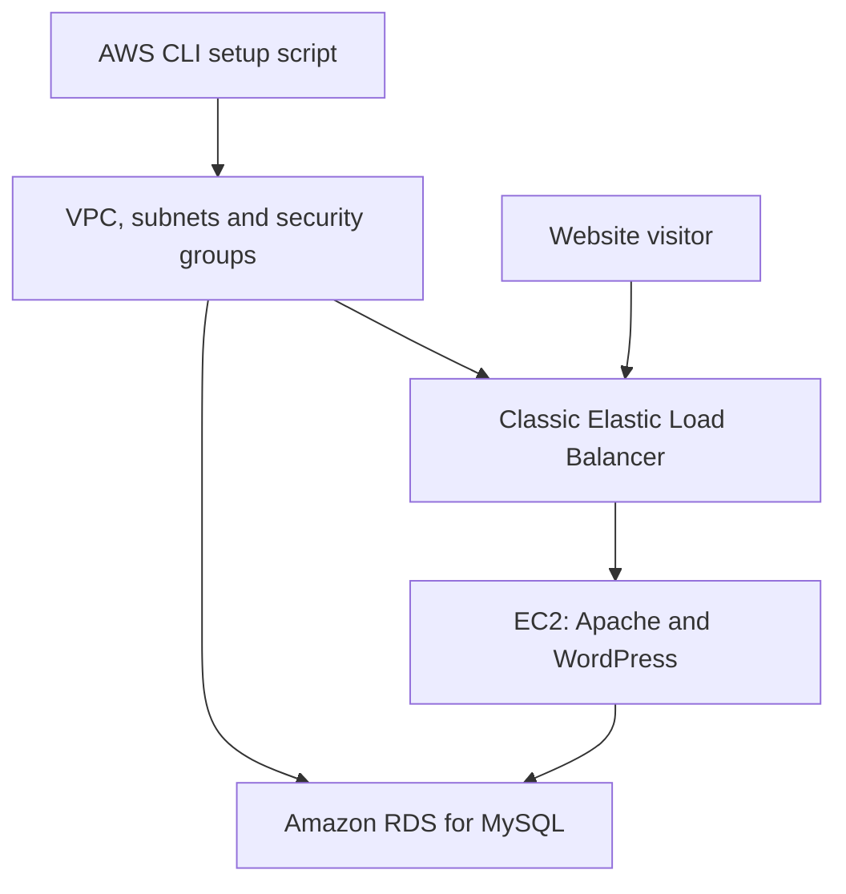

# AWS Demos

A collection of AWS CLI scripts and hands-on service walkthroughs, forked from [miztiik/AWS-Demos](https://github.com/miztiik/AWS-Demos). The main walkthrough builds a WordPress website on EC2 with a MySQL RDS database.

**Status:** These are learning examples, with historical service versions and configuration values. Each demo is independent.

## Representative architecture: WordPress demo

## Start here

Browse [How-To/](How-To/) for individual tutorials and [CLI-Scripts/setup-aws-2tier.sh](CLI-Scripts/setup-aws-2tier.sh) for the WordPress example. Review and update the script's region, AMI, database settings and access rules before running it in a sandbox.

[Previous README and detailed reference](https://github.com/mtzanida/AWS-Demos/blob/d376a5cc6a22810e460024dee21b222693812592/README.md) are retained in Git history. They may describe older assumptions or unmerged plans; the scope above reflects this branch.
